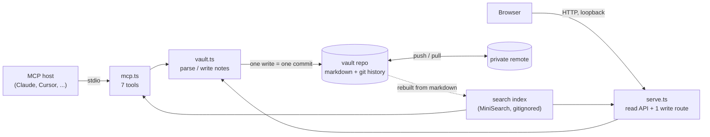

# Architecture

Memex is a git repository of markdown files with an MCP server and a small web UI bolted on. Almost every interesting property falls out of that choice, so this page is mostly about why.

## Git is the engine

The vault is an ordinary git repo, kept separate from this code. A note is `<project>/<slug>.md` with YAML frontmatter (`title`, `key`, `status`, `source`, `session`, `why`, timestamps). Every write the server makes is exactly one commit, authored as the writing agent (`mcp/claude-desktop`, `web/ui`) with the note id, the `why` and the session id in the message. All git calls in a process go through one promise queue (`git.ts`), because an MCP write, an editor and a sync hitting `.git/index.lock` at once is a real failure, not a theoretical one.

Nothing is ever deleted by the tool. Resolving a conflict marks the loser `superseded` and links it to the winner; the history is the record.

## Markdown is the source of truth; the index is a projection

Search runs over a MiniSearch index that lives in `.memex/`, which is gitignored. It is derived entirely from the markdown, refreshed by an mtime sweep, and `memex reindex` rebuilds it from nothing. Because it holds no data the files don't, it never needs backing up, never needs merging between machines, and can be replaced.

That is the pluggability argument. The index sits behind a small interface (search, backlinks). The planned replacement is Postgres with pgvector: a server both machines point at, which is also the natural backend for shared team memory and for embedding-based recall. Swapping it is an adapter change; the notes, the commits and the data model do not move. MiniSearch is the v1 choice because it is pure JS with no native build step (see below), not because it scales forever.

## What falls out of git

**Provenance.** Who wrote a note, in which session and why is in the frontmatter and in the commit. `git blame` and `git log -- <file>` answer "why does the agent believe this?" with no extra machinery.

**Contradiction detection.** Detection is deliberately dull and deterministic (`conflicts.ts`). Two notes collide only if they are active, share a `project` and a `key`, are not linked by `Supersedes:`, and assert different *values* (numbers, names, code spans, identifiers). It under-flags on purpose: restatements and prose rewordings never trigger it, because a detector that cries wolf gets ignored. `remember` runs it at write time and returns the warning to the agent. The Conflicts inbox runs the same function over every pair, so a contradiction is visible to a human even if the agent ignored the warning. No embeddings, no LLM in the loop; semantic detection is a later milestone.

**Write-time key hygiene (`keys.ts`).** Because detection is keyed on an exact-equal `key`, two notes about the same thing filed under different key strings never get compared. So when the author passes a `key`, `remember` also checks whether the project already uses a near-certainly-equivalent key and, if so, appends an advisory `NUDGE:` line suggesting they reuse it — nudging notes to converge onto shared keys the judge can then pair. It never rewrites the key or blocks the save. It is tuned to under-suggest even harder than the judge (a wrong nudge trains the author to ignore every nudge): it fires only when two keys are almost surely one name spelled two ways — identical once separators are dropped (`data-store` ≡ `datastore`), or a first-letters initialism (`ci` ≡ `continuous-integration`). A bare token subset (`storage` vs `storage-choice`) or a single-character edit (`cost` vs `cast`) stays silent, because a more specific key is usually a different fact and an edit-of-one cannot be told from a different word.

Resolution is also a commit. `keep A` / `keep B` supersede the loser; `keep both` requires a reconciliation note and leaves `Reconciled with:` lines that silence the pair. State lives in the markdown (a status field and body lines), so a resolution made on one machine reaches the other through a normal pull.

**Time-travel.** The history of every note is already there. Reconstructing "what the brain knew on date X" is `git log`/`git show` at a commit; a diff between two points is `git diff`. The UI for this is not built yet (roadmap v0.4); the data is.

## Multi-machine sync

The vault has an optional `origin` pointing at a private remote (`memex init --remote <url>`); each machine clones it and works offline-first. Today sync is plain `git pull --rebase` and `git push`, run by you; the server never pushes on its own. A two-machine edit collision is a merge conflict, which is the same class of problem as a contradiction and is meant to surface in the same inbox (a `status: conflict` note with no detected counterpart is listed there already). Auto-sync on `serve` start is planned, not built. Keep the vault out of Dropbox, iCloud and OneDrive: file-sync on top of git corrupts `.git`.

## The web server and its one write

`serve.ts` is `node:http` with no framework ([ADR 5](docs/adr/0005-no-http-framework.md)). It binds loopback and serves a read-only JSON API plus the built UI. The one exception is `POST /api/conflicts/resolve`, which calls the same `Vault.resolveConflict` as the MCP tool. Because it is the only write on an otherwise read-only surface, it is gated: loopback peer, loopback `Host` header (against DNS rebinding), same-origin `Origin`, and `application/json` only (which browsers won't send cross-site without a preflight the server never grants).

## Constraints that shaped the stack

Memex has to run on macOS and Windows and sync between them.

- **No native dependencies.** `better-sqlite3` and friends need a toolchain on both OSes; MiniSearch and `simple-git` do not.
- **Filenames are slugs** (`[a-z0-9-]`, max 60, Windows reserved names banned). `Storage.md` and `storage.md` are one file on both OSes and two in git, which leaves a permanently dirty tree. Titles are slugified and collisions get a suffix.
- **Line endings.** The vault ships `.gitattributes` (`eol=lf`); the code strips `\r` and BOMs on read, always writes `\n`, and hashes normalized text, so CRLF never looks like a change.
- **stdout is the MCP protocol.** One stray `console.log` corrupts the stdio stream, so `console.error` is the only allowed console call in `src/` (enforced by ESLint).
- **Absolute paths for hosts.** Desktop apps often can't resolve `npx`, so configs use absolute paths to `node` and `dist/mcp.js`.

## Known limits

Detection is keyed: two notes with no shared `key` are never compared — the write-time nudge (`keys.ts`) softens this by steering authors onto shared keys, but only for the few near-certain cases it dares suggest. Value-token matching misses contradictions expressed purely in prose. Every request re-reads the vault from disk, which is fine for hundreds of notes and is the first thing to change for thousands. Decisions with fuller reasoning are in [docs/adr](docs/adr).
