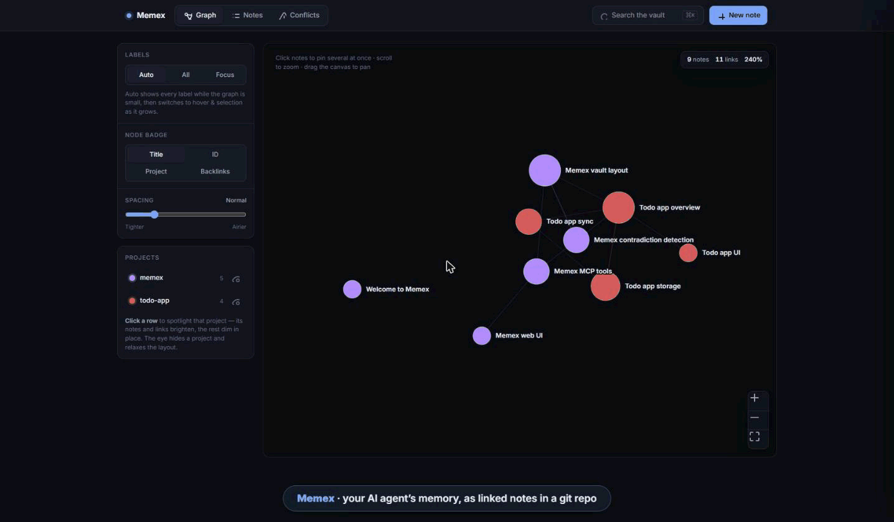
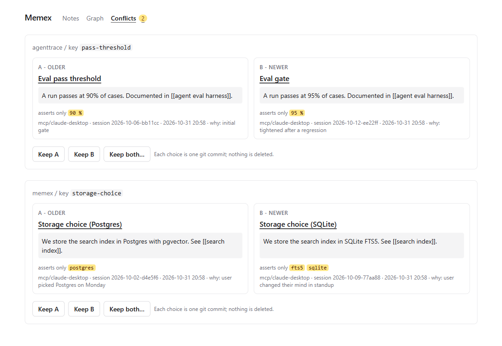

# Memex

### Accountable memory that doesn't rot.

Your AI agent's memory is a git repo it can reason about. Every fact records who wrote it and why. When a new note contradicts an old one, the agent is told on the spot and you get an inbox to settle it. Nothing is overwritten; the history is the audit trail.


[](https://glama.ai/mcp/servers/ronmasuary/Memex)





Memex is a git-backed markdown knowledge base that any [MCP](https://modelcontextprotocol.io) host (Claude Desktop, Cursor, your own agent) can read and write. Your notes are plain `.md` files you own, not rows in someone's database. How it works, in one page: [ARCHITECTURE.md](ARCHITECTURE.md).

> **Status:** pre-release, in active development. Brain, Graph and Conflicts (v0.1 to v0.3) are feature-complete: seven MCP tools, contradiction warnings, a browse UI, a force-directed graph and a conflicts inbox. Not yet tagged. See the [roadmap](#roadmap).

## Why it doesn't rot

Most "agent memory" is a bucket of embeddings that silently rots: stale facts linger, contradictions pile up, and you can never ask *why* the agent believes something. Memex is built on one engine, **git**:

| Pillar | What it means | Powered by |
|---|---|---|
| **Provenance** | Every note records which agent and session wrote it, when, and why. One write is exactly one commit. | frontmatter + git commits |
| **Contradiction detection** | A write that collides with an existing note on the same `key` comes back to the agent as a warning. Unresolved collisions wait in the **Conflicts inbox**, where keep A, keep B or keep both (with a reconciliation note) is one click and one commit. | deterministic checks |
| **Time-travel** | Ask what the brain knew on date X, and diff any two points. *(UI planned, v0.4; the history is already in git.)* | git history |

The detector is tuned to **under-flag**, because a tool that cries wolf is dead by lunchtime. Its [correctness suite](src/conflicts.fixtures.ts) is mostly cases that assert *nothing* flags (restatements, explicit supersedes, unrelated notes with similar wording). It is the seed of an evals story, not one yet.

## Quickstart (about 60 seconds)

Needs Node 20+ and git.

```bash
git clone https://github.com/ronmasuary/Memex.git && cd Memex
npm run setup                          # installs + builds server, CLI (dist/) and UI (web/dist/)
npm link                               # optional: puts the `memex` command on your PATH
memex init ~/memex-vault               # creates a git repo with a seed note
memex serve --vault ~/memex-vault      # http://127.0.0.1:4321
```

No `npm link`? Run the same commands as `node dist/cli.js init …` / `node dist/cli.js serve …`.

Keep the vault out of Dropbox, iCloud and OneDrive (cloud sync plus git corrupts `.git`). `memex find <query>` searches from the terminal.

Each vault is its own git repo. `memex init` stamps a committer identity onto it (your git config by default, or `--name "Ada Lovelace" --email ada@example.com`) and prints it, so the initial commit is signed by a real author rather than inheriting a stale global default.

## Connect an MCP host

Desktop hosts can't resolve `npx` or a PATH `bin`, so the config needs **absolute paths** to `node` and `dist/mcp.js`. Instead of hand-writing them (and escaping backslashes on Windows), let Memex print the exact block with paths already resolved:

```bash
memex mcp-config --vault ~/memex-vault              # Claude Desktop (default)
memex mcp-config --vault ~/memex-vault --host cursor # Cursor
```

It prints a ready-to-paste `mcpServers` block and tells you which file to merge it into for your OS. Merge it, then **fully restart the host**. For reference, the block looks like this (your paths will be absolute and OS-correct):

```json
{
  "mcpServers": {
    "memex": {
      "command": "/absolute/path/to/node",
      "args": ["/absolute/path/to/Memex/dist/mcp.js"],
      "env": { "MEMEX_VAULT": "/absolute/path/to/memex-vault" }
    }
  }
}
```

Config file locations: Claude Desktop — `~/Library/Application Support/Claude/claude_desktop_config.json` (macOS) or `%APPDATA%\Claude\claude_desktop_config.json` (Windows); Cursor — `~/.cursor/mcp.json` (global) or `.cursor/mcp.json` (per project).

Hosts don't call memory tools unprompted. Paste the short block from [MEMEX.md](MEMEX.md) into your `CLAUDE.md` or Cursor rules so the agent actually uses them.

## MCP tools

| Tool | Purpose |
|---|---|
| `remember` | Create or update a note, one git commit, returns contradiction warnings |
| `recall` | Ranked search: title, id, 200-char snippet, max 8 hits |
| `read_note` | Full body of one note, capped by `maxChars` |
| `get_backlinks` | Notes that link to a given note |
| `list_notes` | Browse by project or tag |
| `list_tags` | Tags with counts |
| `resolve_conflict` | Settle a contradiction: keep A, keep B, or keep both with a note. One commit; nothing deleted. Agents should use it only when you've decided |

Every tool caps its output so a memory lookup never floods the host's context.

## The web UI

`memex serve` is a browser for the vault (read-only, with one exception: resolving a conflict, which is loopback-gated): notes grouped by project, rendered markdown with clickable `[[wikilinks]]`, a backlinks panel, a provenance badge, and a **force-directed graph** of notes and links (`/graph`). In the graph, color is the project, size is backlink count, hover shows the title, click opens the note, and the project and tag filters re-lay-out what is left. The **Conflicts** tab lists every unresolved contradiction side by side, with each note's differing values and provenance, and the resolve actions. It follows your system light/dark setting.

## How it works

- **Source of truth:** markdown + YAML frontmatter, one note per file (`<project>/<slug>.md`), in a git repo separate from this one.
- **Index:** a rebuildable, gitignored [MiniSearch](https://github.com/lucaong/minisearch) projection, refreshed by an mtime sweep. No native dependencies. Postgres + pgvector can slot in later behind the same interface.
- **Multi-machine:** the vault is a git remote; clone it on your Mac and your Windows box.
- **Stack:** TypeScript (Node 20, ESM), `@modelcontextprotocol/sdk`, `node:http` (no framework), React + Vite + Tailwind, `d3-force` with hand-written SVG. CI on ubuntu, macOS and Windows. Decisions are recorded in [docs/adr](docs/adr); the whole design is in [ARCHITECTURE.md](ARCHITECTURE.md).

## Roadmap

- [ ] **v0.1 — Brain.** Markdown store, MCP read/write/search, contradiction warnings. *(built, not yet tagged)*
- [ ] **v0.2 — Graph.** Wikilinks, backlinks, browse UI and the force-directed graph. *(built, not yet tagged)*
- [ ] **v0.3 — Conflicts.** The contradiction inbox and resolve actions. *(built, not yet tagged)*
- [ ] **v0.4 — Time-travel.** Scrub the brain's history; diff any two points.
- [ ] **v0.5 — Recall.** Embeddings and hybrid semantic search on Postgres + pgvector (Docker lands here).
- [ ] **v0.6 — Obsidian sync.** Point Memex at a real Obsidian vault, two-way.
- [ ] **Later:** team and shared memory, a LangGraph memory adapter.

## Contributing

Issues and ideas welcome; see [CONTRIBUTING.md](CONTRIBUTING.md). Licensed [MIT](LICENSE) © Ron Masuary.
